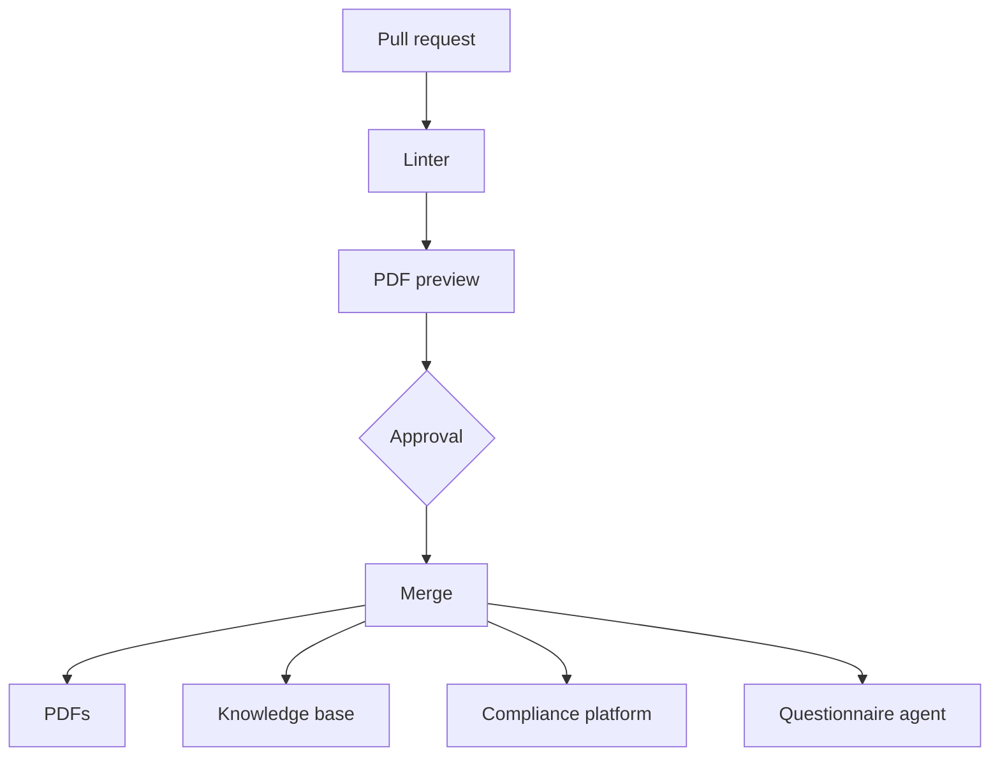

Last spring I changed one sentence in our access control policy. It took me about an hour.

The sentence took a minute. The rest was the ritual: edit the page in our document tool, export it, upload the export to the compliance platform, then go and record who approved it and when. If you've run a SOC 2 or an ISO 27001 programme you know this ritual. You've probably also typed an approval date into a field from memory, which is a funny thing to call evidence.

We have 33 of these documents (policies, plans, procedures, the whole family), each in English and French. I didn't want to do that 33 times a year, and I really didn't want to redo all of it the day we change compliance platform. So in May I moved them into a git repository, and I've been surprised by how much else that fixed.

```stats
33     | policies, plans and procedures
58     | pull requests merged since June
10 min | from edit to everywhere, down from an hour
```

## A policy is a Markdown file

There isn't much to it. One file per policy, plain Markdown, with a header on top that carries what the compliance platform used to hold for us:

```yaml
title: Access Control Policy
version: "3.3"
owner: Security Team
approved_by: The CTO
last_reviewed: 2026-06-09
next_review: 2027-06-09
frameworks:
  - SOC2
  - ISO27001
classification: internal
```

Each file ends with a version history table: version, date, what changed, who approved it. I decided early that the table is the record and the header just has to agree with it. Otherwise you get two sources of truth inside a single file, which is impressive but not what we're going for.

## What happens when someone changes one



Anyone with access to the repository can open a pull request. In practice it's almost always someone from security, since most of the company doesn't work in git (more on that below). Whoever approves the pull request is the approver of record for that version, which for most policies means our CTO. There's no form to fill in afterwards. The review is the approval.

A linter runs first. It's a few hundred lines of bash and awk with no dependencies, and its job is to stop a broken policy from being published: one whose header says version 3.3 while its history stops at 3.2, or whose next review is already in the past. It checks that the header has every field, that its version, date and approver match the top row of the history table, and that the next review is exactly a year after the last one. Yes, it handles 29 February. It also warns when a French translation has fallen behind its English source, but it won't block the merge for that, because a stale translation you can see beats an English fix you can't ship.

Then CI builds a PDF of whatever changed and attaches it to the pull request, and the description of the pull request sums up what changed and why. This matters more than I expected. Our CTO doesn't want to approve a Markdown diff, and he shouldn't have to: he reads the summary, then the document the way an auditor or a customer will get it.

Once it's merged, CI publishes it everywhere. Nobody exports anything.

## Is a pull request really an approval?

I think it's a better one than what we had.

The main branch is protected, so nothing lands without a review from the owner, and commits are signed. For any version of any policy I can show you the exact lines that changed, who proposed them, who approved them and at what time. Before, I could show you a PDF and a date somebody typed.

> [!NOTE]
> Employees still acknowledge policies in the compliance platform. We moved where policies are written and approved. Where people read and sign them hasn't changed.

## Where a policy ends up

Four places, all fed by the same merge.

The PDFs are built with Pandoc and Tectonic, on a template with our branding. I spent longer on that template than I'd like to admit, but these are the copies customers see during a deal, and the old exports looked like exports. The build is reproducible too: the timestamp is pinned to the policy's review date, so the same commit gives the same file, byte for byte.

The internal knowledge base gets a read-only copy of every policy. I'll come back to why. If someone edits a page there, the next publish quietly overwrites it.

The compliance platform gets each merged policy as a new version. It still does what it's good at, which is collecting acknowledgements and showing the auditor a familiar screen.

And our questionnaire agent reads the repository directly.

## The platform is now just a destination

This is the real reason I started, so I'll be plain about it. We're looking at moving to another compliance platform. When the platform holds the only good copy of your policies, along with their versions and their approvals, that's a hard conversation. You don't really own them. You have an export button.

With the policies in git, that part of a move is one sync script. I'd be lying if I said the whole migration is that easy (it isn't, there's a lot more in a compliance platform than policies), but this piece went from a project to an afternoon.

## The agent got better, which I didn't plan

We have an agent that answers security questionnaires for our sales team. I [wrote about it](/build-the-small-tool/) before. For a long time its answers were generic and, more often than I liked, wrong. It knew roughly what a security policy says. It didn't know what ours say.

Pointing it at the repository fixed most of that, because now it quotes the same text the auditor reads. It didn't fix everything, and the reason is a bit ironic. Good policies are deliberately vague about the how. Ours say "the monitoring platform", and then a customer asks which monitoring platform.

So there's a second folder, next to the policies, that we call facts: which vendor, which date, which number, and what we answer to questions no policy covers. The rules are stricter than for policies. Every fact names its source, and every file carries the date somebody last checked it against those sources. After twelve months the agent treats it as stale.

The rule I like most is that the agent never writes a fact. When it can't answer something it logs the gap and opens a pull request, and a human supplies the answer with a source. I've seen what happens when you let a model fill in its own knowledge base, and I'd rather get an escalation than a confident guess that nobody re-checks.

## We draft with a model, and only draft

Policies get drafted with a model, through a skill that holds two things: how our policies should sound, and what the frameworks expect to find in them.

The tone rules are the kind you'd give a new hire. Write something an auditor can test, so "backups must be tested at least annually" and never "we strive to test backups regularly". *Must* is a requirement, *may* is a permission, and *should* is only allowed when there's a documented way to get an exception.

The other half is about altitude, and it's the one I'd steal if I were you. A policy says what we guarantee and who's responsible. A runbook says how. The test: if we renamed a cluster or switched cloud provider tomorrow, would this policy need an edit? If so, that detail belongs in a runbook.

The model writes the first version. A person rewrites it, and the approver approves it. I don't see that changing soon.

## What I got wrong

I didn't know where our policies were. I knew where the source was, obviously. But a policy gets copied into more places than you'd think: a trust page, a sales folder, an onboarding checklist, the answers to a questionnaire from two years ago. Replacing the source took a day. Finding the copies is still not finished, and I never had a map.

People kept using old exports. For weeks after the switch, colleagues who don't live in git went on sharing PDFs they'd downloaded months earlier. That one's on me. I'd changed the source of truth and announced it to the people who already knew. The read-only copy in the knowledge base should have shipped on day one. It shipped later, after I noticed.

And not everyone is on git. I haven't tried to change that (yet). It's simply how the company works today, and for now I think that's fine: the repository is where policies get written, and everywhere else is where they get read. It does mean every new destination is a sync I have to build and maintain, so it isn't free.

## What I'd do next

I'd move more of what we know into git. Probably a lot more.

I used to think of source control as a thing for code. What it actually gives you is history, ownership and review on every line, and it turns out that's exactly what an agent needs from the things it reads. A page in a document tool can't tell an agent who last checked it, or whether it's the current copy. A file in a repository can. And when the agent says something wrong, there's one place to fix it and the fix gets reviewed like any other change.

I'm not certain how far this goes. Policies were an easy first case: few authors, slow change, strict review. Runbooks, vendor reviews and the hundred small decisions that live in chat threads are messier, and I haven't worked out how to get people who'll never open a pull request to contribute to them. But if agents are going to answer customers in our name, I want what they read to have been through a review. Policies are where we started.
